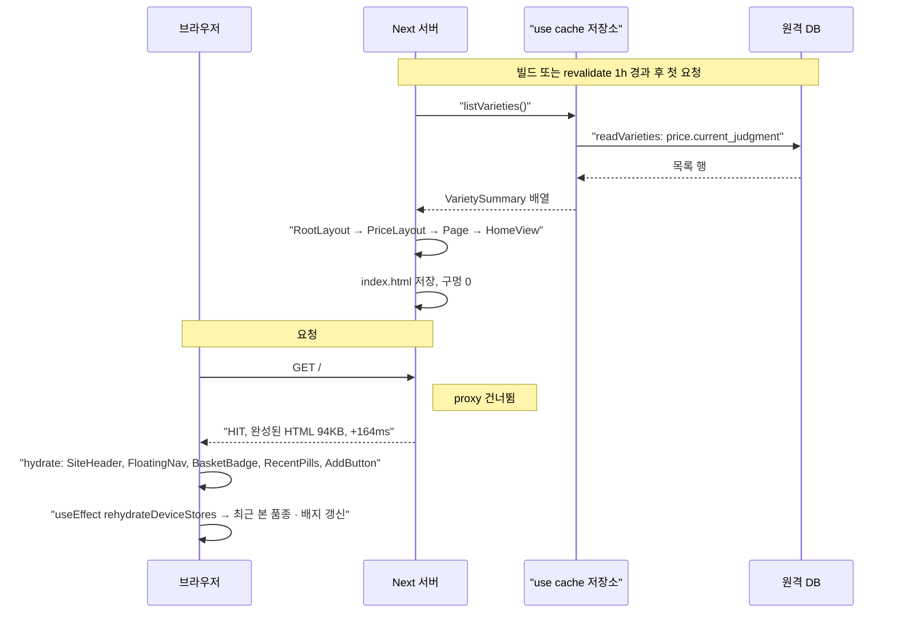

# `/` P1 시세 메인

**통째로 정적(○)이다. `listVarieties`의 `cacheLife("hours")`가 라우트 수명이 되어 revalidate 1시간 · expire 1일로 다시 만든다.** 빌드 표: `○ /  1h  1d`.

## 1) 호출 경로

1. `proxy.ts:10`: matcher가 `/seasonal/festivals`뿐이라(`proxy.ts:17`) 실행되지 않는다.
2. `app/layout.tsx:30` `RootLayout`: 정적 `metadata`(`:14`, `createMetadata` · `siteUrl` · `searchVerification`, 환경변수만 읽음). `<Providers>`(`:38`, `shared/providers.tsx:11`의 `'use client'`, `TooltipProvider` → `OverlayProvider`, 마운트 뒤 `rehydrateDeviceStores`). `</body>` 뒤에 `<AnalyticsTag />`(`:40`).
3. `app/(price)/layout.tsx:4` `PriceLayout` → `PriceShell`(`features/price/components/price-shell.tsx:6`) → `SiteShell`(`shared/shell/site-shell.tsx:8`). 건너뛰기 링크, `SiteHeader`(`site-nav.tsx:121`, client), `<main id="main">`, `FloatingNav`(`site-nav.tsx:27`, client)로 이루어진다. 담은 품종 배지 `BasketBadge`(`basket-badge.tsx:8`)는 client다.
4. `app/(price)/page.tsx:15` `Page`(async, `<Suspense>` 없음): `getPriceSource()`(`:16`) → `Promise.all([listVarieties(), featuredIds()])`(`:17`).
5. `<JsonLd data={[website(), organization()]}>` + `HomeView`(`features/price/home/home-view.tsx:12`, server). 하는 일: `pickByIds`로 대표 품종을 고르고, `latestSurveyedOn`으로 조사일, `listBasisLine`으로 근거 한 줄을 만든다.
6. `HomeView` 안의 말단:
   - server: `SearchEntry`(`search-entry.tsx:14`, `/search`로 가는 Link라 `/`이 `searchParams`를 읽지 않는다), `VarietyRow` · `PriceHint`(`variety-row.tsx`).
   - client: `RecentPills`(`recent-varieties.tsx:21`, `price:recent`), `AddButton`(`add-button.tsx:14`, 담기 토스트는 overlay).

## 2) 정적 셸 / 스트리밍 / 하이드레이션

- **프리렌더**: `.next/server/app/index.html` 100,811B다. Suspense 구멍 0개, 닫힌 완전한 문서다. `index.meta`에는 `x-nextjs-prerender: 1`이 있고 `"postponed"`는 없다.
- **응답**(`next start`): `x-nextjs-cache: HIT`, `cache-control: s-maxage=3600, stale-while-revalidate=82800`. 94,669자 전부가 +164ms까지 왔고 구멍은 0개다. 계란 · 양파 · 사과 · 고등어 · 애호박 · 샤인머스캣이 가격과 판정 알약까지 HTML에 들어 있다. RSC flight payload는 70,429자다.
- **스트리밍**: 없다.
- **하이드레이션**: 헤더 · 하단 내비(`usePathname`, 스크롤 상태), `BasketBadge`, `RecentPills`, `AddButton`. 첫 렌더는 기본값(빈 최근 목록, 배지 0, 담기 안 됨)으로 그린다. `Providers`의 `useEffect`가 localStorage를 불러온 뒤 최근 본 품종 알약과 담음 표시가 나타난다.

## 3) 데이터 조회

`getPriceSource()`(`features/price/data/price-source.ts:28`)가 `dbSource`(`db-source.ts:45`)를 돌려준다.

- `listVarieties`(`db-source.ts:20-24`): `'use cache'` + `cacheLife("hours")`(stale 5분 · revalidate 1시간 · expire 1일) → `readVarieties(db())`(`queries/list-varieties.ts:10`). 이 쿼리는 `price.current_judgment`를 variety · item · category와 join하고, 행마다 `varietySummarySchema.safeParse`로 검사한다. 어긋난 행은 빼고 `console.error`를 남긴다.
- `featuredIds`(`db-source.ts:49`): `FEATURED_IDS` 상수(`featured.ts:3`)를 돌려주는 async 함수다. DB를 읽지 않는다.
- 접속: `db()`(`db.ts:14`)가 처음 부를 때 `postgres(WEB_DATABASE_URL, { prepare: false, max: 3, idle_timeout: 20 })`를 `globalThis`에 하나 만든다. 롤은 `web_reader`, Supavisor 트랜잭션 모드다.

`Page`가 `<Suspense>` 없이 최상단에서 DB를 await하는데도 정적인 이유는 `listVarieties`가 `'use cache'`이기 때문이다. 캐시된 결과는 프리렌더에 들어간다.

## 4) 라우트 설정

- `generateStaticParams`: 해당 없음(param 없음).
- 메타데이터: 정적 `export const metadata = createMetadata({ ...homeSeo(), path: routes.home, ogImage })`(`app/(price)/page.tsx:8`).
- notFound: 없음. DB 오류는 그대로 던져 `app/error.tsx`가 받는다.
- 오늘: 쓰지 않는다. `connection()`도 없다.

## 흐름도

## 주의할 점

- `listVarieties`에서 `'use cache'`를 빼면 `/` 전체가 요청 때 렌더로 바뀐다. 최상단 await라 Suspense 경계가 없어서 blocking route가 된다. 목록을 바꿀 때 이 지시어는 유지한다.
- 새 판정은 최대 약 1시간 뒤에 보인다(README "cacheTag가 없다").
- `featuredIds`는 상수라 캐시 대상이 아니다. 나중에 DB에서 읽게 바꾸면 `'use cache'`를 붙여야 `/`이 정적으로 남는다.
