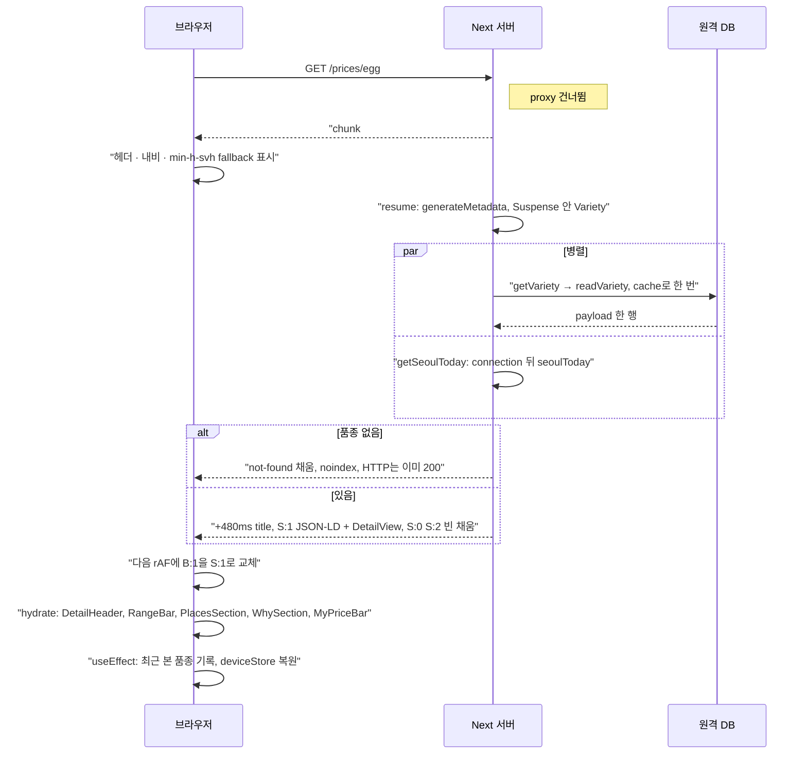

# `/prices/[variety]` P3 품종 상세

**부분 프리렌더(◐)다. 셸(헤더 · 내비 · fallback)만 정적이고, `<title>`을 포함한 메타데이터와 본문은 매 요청 DB와 서울 기준 오늘로 그려 스트리밍한다.** 빌드 표: `◐ /prices/[variety]`, `◐ /prices/egg`, `◐ /prices/onion`, `[+4 more paths]`.

## 1) 호출 경로

1. `proxy.ts`: 실행되지 않는다(matcher 밖).
2. `app/layout.tsx:30` → `app/(price)/layout.tsx:4` → `PriceShell` → `SiteShell`(01과 같다).
3. `app/(price)/prices/[variety]/page.tsx:24` `generateMetadata`: `await props.params`, 그다음 `getPriceSource().getVariety(id)`를 `<Suspense>` 밖에서 await한다. 본문도 미뤄지므로 허용되고, 메타데이터는 본문과 함께 요청 때 스트리밍된다. 품종이 없으면 `{}`를 돌려준다(여기서는 `notFound()`를 부르지 않는다).
4. `:35` `Page`(sync) → `<Suspense fallback={
}>`(`:37`) → `Variety`(`:43`, async).
5. `:44` `Promise.all([getVariety((await params).variety), getSeoulToday()])`. `:45` 없으면 `notFound()` → `app/not-found.tsx`(가격 셸로 그림).
6. `<JsonLd data={breadcrumb(...)}>` + `DetailView detail today={isoDate(today)}`.
7. `DetailView`(`features/price/variety-detail/detail-view.tsx:16`, server):
   - client: `DetailHeader`(최근 본 품종 기록, 뒤로, 담기), `DetailHeaderBar`(헤더 안으로 portal), `RangeBar`, `PlacesSection`, `WhySection`(안에 client `TrendChart`, server에서 그린 `DotsCompare`를 prop으로 받음), `MyPriceBar`(`detail.usual != null`일 때만, 바텀시트는 overlay).
   - server: `VerdictCard`(today로 "2주 전" 같은 오래됨 표시), 근거 한 줄 `
`.

## 2) 정적 셸 / 스트리밍 / 하이드레이션

- **프리렌더**: `prices/egg.html` 8,850B, 구멍 3개, 닫히지 않은 셸이다. `<title>`이 없다. `.meta`에 `"postponed"`가 있다. 대표 품종이 아닌 id용 일반 셸 `prices/[variety].html`도 있다.
- **`/prices/egg` 응답**: `x-nextjs-postponed: 1`, `cache-control: private, no-store`.
  - chunk#0(+165ms, 8,850B)은 프리렌더 셸과 정확히 같다. 보이는 글자는 건너뛰기 링크, 헤더 내비(시세 · 제철달력 · 담은 품종), 하단 내비다.
  - 구멍: B:1은 `<main>` 안의 페이지 Suspense다(fallback `
`). B:0은 `<body>` 맨 위의 `
` 안, B:2는 main 안 B:1 바로 앞에 있다. 둘은 fallback도 채움(S:0 · S:2)도 빈 div다. Next 내부의 메타데이터 · viewport 경계로 **추정**한다.
  - +480ms(DB 왕복 뒤)에 나머지가 온다. `<title>계란 시세 · 평소 가격 | 장볼날</title>`이 `<body>` 안 스크립트 뒤로 먼저 오고, 이어서 S:1 · S:0 · S:2가 온다. S:1 = BreadcrumbList JSON-LD + 본문 article("계란 일반란 · 30구", "판정 전", "지금 시세 6,875원", "10/30 조사", "어디서 얼마에 팔까", "가격 흐름 보기" …).
  - 전체 71,835자, RSC payload 54,830자.
- **`/prices/avocado`(대표 품종 아님)**: `x-nextjs-prerender: 1` + postponed로 응답한다. 일반 `[variety]` 셸을 먼저 보내고 `<title>`과 본문을 스트리밍하며, +924ms에 끝난다.
- **하이드레이션**: 셸의 헤더 · 내비, 채운 본문의 client 말단(위 7번). `DetailHeader`는 마운트 뒤 `useEffect`로 최근 본 품종(`price:recent`)에 이 품종을 넣는다. 내가 본 가격(`RangeBar` · `MyPriceBar`)은 저장하지 않는 메모리 store다.

## 3) 데이터 조회

- `getVariety`(`features/price/data/db-source.ts:43`): `'use cache'` 없이 React `cache()`만 씌웠다. 그래서 요청마다 `readVariety(db(), id)`(`queries/get-variety.ts:7`)가 DB를 읽는다. 쿼리는 `select payload from price.current_judgment where payload ->> 'id' = $id limit 1`이고, `varietyDetailSchema.parse`가 모양이 어긋나면 던진다. 같은 요청 안의 `generateMetadata`와 `Variety`는 `cache()` 덕에 한 번만 읽는다.
- `generateStaticParams`의 `featuredIds()`: 상수다. DB를 읽지 않는다.
- 빌드 때 대표 품종 6개의 프리렌더가 `getVariety`를 부르는지는 **미확인**이다. 셸에는 그 결과(제목, 본문)가 남지 않는다.

## 4) 라우트 설정

- `generateStaticParams`(`page.tsx:19`): `featuredIds()`가 6개를 낸다(`egg`, `onion`, `apple`, `mackerel-kr`, `korean-zucchini`, `shine-muscat`; `featured.ts:3`). 다른 id는 일반 셸로 요청 때 그린다. Cache Components라 `dynamicParams`를 쓸 수 없다.
- 메타데이터: `generateMetadata`(`:24`)가 `createMetadata({ ...varietySeo(variety), path, ogImage })`를 돌려준다.
- notFound: 본문 `:45`에서만 부른다. 셸을 보낸 뒤라 HTTP 200 + `noindex`가 된다(README).
- 오늘: `TodayProvider` 없이 `getSeoulToday()`를 직접 await하고(`:44`), `isoDate(today)` 문자열로 내린다.

## 흐름도

## 주의할 점

- 본문 전체가 요청 시점인 이유는 오늘(조사일 경과 표시)과 캐시 없는 `getVariety` 두 가지다. 둘 중 하나만 없애서는 셸이 커지지 않는다.
- `<title>`이 셸이 아니라 DB 결과와 함께 온다. 셸만 보는 도구(일부 링크 미리보기)는 루트 기본 제목을 볼 수 있다. **미확인**: 실제 미리보기 봇이 스트림 끝까지 읽는지.
- 대표 품종 밖의 id는 일반 셸을 거쳐 더 늦게 끝났다(+924ms vs +481ms). 측정은 한 번뿐이라 원인(콜드 커넥션 등)은 **미확인**이다.
