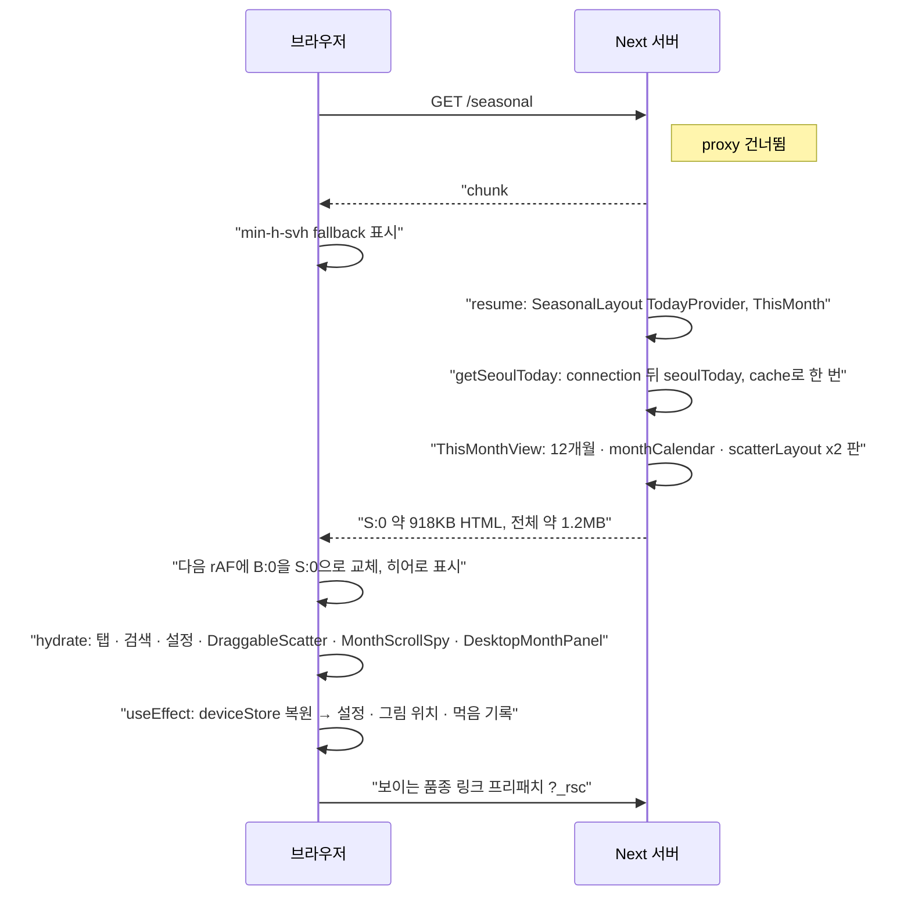

# `/seasonal` 2a 이달

**부분 프리렌더(◐)다. 셸(헤더 · 이달/월별 탭 · 검색 · 하단 내비)은 정적이고, 2a 본문 전체는 서울 기준 오늘이 필요해 요청 때 그려 한 번에 스트리밍한다.** 빌드 표: `◐ /seasonal`.

## 1) 호출 경로

1. `proxy.ts`: 실행되지 않는다(matcher는 `/seasonal/festivals`만).
2. `app/layout.tsx:30` `RootLayout` + `Providers`.
3. `app/seasonal/layout.tsx:5` `SeasonalLayout`(sync): `getSeoulToday()`를 await하지 않고 Promise로 `TodayProvider`(`:8`, `shared/today-context.tsx:11`)에 넘긴다. 그다음 `SeasonalShell sheet={sheet}`가 이어진다.
4. `features/seasonal/components/seasonal-shell.tsx:15` `SeasonalShell` → `SiteShell(area="seasonal")`.
   - `tabs`: `HeaderSubTabs`(`sub-tabs.tsx:115`, client).
   - `actions`: 검색 버튼(모바일/데스크톱), `ThisMonthOnly`로 감싼 설정 버튼. 둘 다 overlay로 연다.
   - `{sheet}` 슬롯은 `SiteShell`의 형제로 붙는다(`:49`). `/seasonal`에서는 `@sheet/page.tsx`가 `null`이다.
5. `app/seasonal/(this-month)/layout.tsx:3` → `ThisMonthTabs`(client) + `children`.
6. `app/seasonal/(this-month)/page.tsx:20` `Page` → `<Suspense fallback={
}>`(`:22`) → `ThisMonth`(`:28`): `await getSeoulToday()`(`:29`) → `ThisMonthView today={today}`.
7. `features/seasonal/this-month/this-month-view.tsx:30` `ThisMonthView`(server):
   - 12개월 데이터(`:33`), 히어로는 `months[thisMonth - 1]`(`:34`).
   - `MonthSection`(`:103`)마다 `festivalsInMonth` · `holidaysInMonth` · `monthCalendar({ today })`(`:117-120`)를 계산한다.
   - `Scatter`(`:170`) → `ScatterField`(`features/seasonal/components/scatter-field.tsx:13`)가 모바일 · 데스크톱 두 판을 그린다. 각 판에서 서버가 `scatterLayout(...)`(`:29`)을 계산한다(`packages/seasonal/src/layout/scatter.ts`, Lloyd `LLOYD_ITERATIONS = 10`).
   - client 말단: `DraggableScatter`(그림 위치 `deviceStore`), `SettingsScope` · `SettingsCalendar`, `MonthScrollSpy`, `DesktopMonthPanel`, `JumpButton` · `MonthRail`, `YearEndSummary`(먹음 기록 수).
   - server: `MoreFoods`, `DownloadsCard`(정적 manifest).

## 2) 정적 셸 / 스트리밍 / 하이드레이션

- **프리렌더**: `seasonal.html` 17,718B, 구멍 1개, `<title>제철 음식 달력 | 장볼날</title>` 포함, `.meta`에 `"postponed"`가 있다.
- **응답**: chunk#0이 +518ms에 온다. 셸이고 구멍 B:0 하나가 이달/월별 보기 탭 바로 뒤에 있다(fallback `min-h-svh aria-busy`). 셸에 보이는 것은 `<title>`, 헤더, 2차 탭, 검색, 하단 내비다.
- **채움**: S:0이 2a 본문 전체다(HTML 918,164자: 히어로 "10월", 12개월, 판 두 벌, 달력). 응답 전체는 1,224,660자(약 1.2MB), RSC payload는 288,203자다.
- 셸을 프리렌더해 두었는데도 첫 바이트가 +518ms였다(다른 ◐ 라우트는 +45~165ms). resume 렌더 준비에 서버 작업이 걸린 것으로 **추정**한다. 원인은 따로 재지 않았다.
- **하이드레이션**: 헤더 · 탭 · 검색 · 설정 버튼, 그리고 본문의 client 말단 전부다. 마운트 뒤 `rehydrateDeviceStores()`가 설정(달력 모양 등), 끌어 옮긴 그림 위치, 먹음 기록을 불러와 다시 그린다.
- **프리패치**: `partialPrefetching` 때문에 화면에 들어온 품종 링크마다 `/seasonal/foods/<id>?_rsc=…` 프리패치와 그 `color.svg` 요청이 나간다(브라우저에서 확인).

## 3) 데이터 조회

없다. 품종 · 달 · 명절 · 공휴일은 모두 `@workspace/seasonal`의 모듈 데이터와 순수 함수다. 제철 영역에는 `'use cache'`도 없다. 요청 시점이 되는 원인은 `getSeoulToday()`의 `connection()` 하나다.

## 4) 라우트 설정

- `generateStaticParams`: 해당 없음.
- 메타데이터: 정적 `createMetadata({ ...seasonalHomeSeo(), path: routes.seasonal.root, ogImage })`(`page.tsx:9`).
- notFound: 없음.
- 오늘: 레이아웃이 Promise를 Context로 나눠 주고(클라이언트 `useToday()`용), 페이지가 같은 `getSeoulToday()`를 await한다. React `cache()`라 한 요청 안에서는 한 번만 계산한다. 서버 컴포넌트는 `today`를 prop으로 받는다.

## 흐름도

## 주의할 점

- 본문 전체가 하나의 구멍이라, 오늘과 무관한 큰 부분(12개월 판의 그림 배치, 품종 목록, 메모)까지 매 요청 다시 그리고 다시 보낸다. 응답 1.2MB 가운데 대부분이 그렇다. 줄이려면 오늘에 기대는 부분(히어로 달, 달력 오늘 표시)만 구멍으로 남기는 방향이 된다.
- `nextjs-16-patterns.md` 5.2는 "처음 스크롤 위치"도 오늘이 정한다고 적었다. 코드에서 오늘을 쓰는 것은 히어로 달과 달력이다. `MonthScrollSpy`는 `#month-N` 해시가 있을 때만 이동한다. 문서와 코드가 다르다.
- 시트를 열면 pathname이 `/seasonal/foods/<id>`가 된다. 그동안 헤더의 2차 탭과 설정 버튼(`ThisMonthOnly`)이 사라지고, `ThisMonthTabs`의 현재 표시가 빠진다(04 참고).
- 스트리밍 교체가 rAF에 묶여 있어, 숨은 탭에서 측정하면 히어로가 안 나타난 것처럼 보인다(README).
