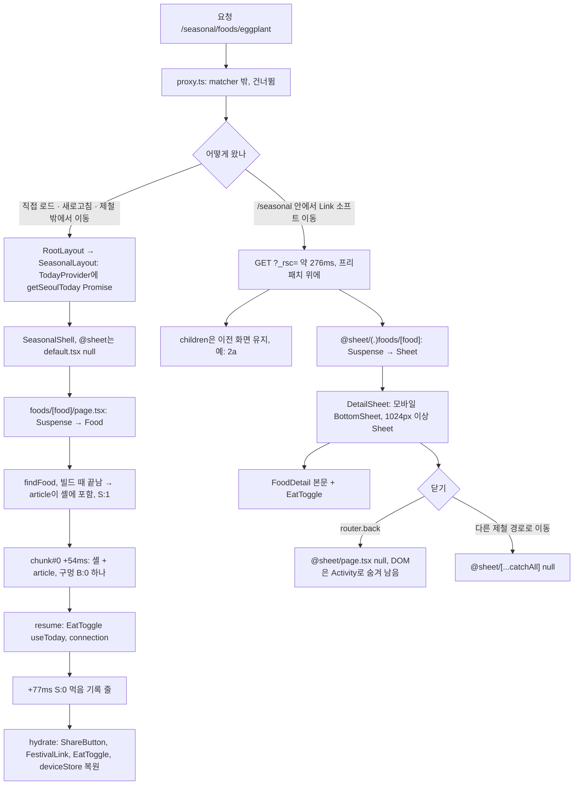

# `/seasonal/foods/[food]` 1i 품종 상세 (전체 페이지 · 시트)

**부분 프리렌더(◐)이고 품종 207개를 모두 빌드한다. 본문 전체가 정적 셸에 이미 들어 있고, 요청 때 채우는 것은 먹음 기록 줄 하나다. `/seasonal` 안에서 소프트 이동하면 `@sheet`가 가로채 시트로 띄운다.** 빌드 표: `◐ /seasonal/foods/[food]`(+207), `◐ /seasonal/(.)foods/[food]`(+207).

## 두 가지 모드

| 모드 | 언제 | 무엇이 그려지나 |
|---|---|---|
| 전체 페이지 | 주소로 직접 열기, 새로고침, 제철 레이아웃 밖(가격 화면 등)에서 이동 | `app/seasonal/foods/[food]/page.tsx`. `@sheet`는 `default.tsx` → `null` |
| 시트 | `/seasonal` 레이아웃 안에서 `Link`나 `router.push`로 소프트 이동 | `children`은 이전 화면(예: 2a) 그대로, `@sheet` 슬롯에 `@sheet/(.)foods/[food]/page.tsx` |

## 1) 호출 경로

공통 앞부분:

1. `proxy.ts`: 실행되지 않는다.
2. `app/layout.tsx:30` → `app/seasonal/layout.tsx:5`(`TodayProvider today={getSeoulToday()}`, Promise) → `SeasonalShell`(`seasonal-shell.tsx:15`). 이 경로는 `(this-month)` 그룹 밖이라 `ThisMonthTabs`가 없다.

전체 페이지:

3. `app/seasonal/foods/[food]/page.tsx:38` `Page` → `<Suspense fallback={
}>`(`:40`) → `Food`(`:46`).
4. `:47` `findFood((await params).food)`. 순수 함수이고 DB를 읽지 않는다. `:48` 없으면 `notFound()` → `app/seasonal/not-found.tsx`.
5. `<article>` 안: `JsonLd breadcrumb`, "‹ 이달의 제철" 링크, `ShareButton`(client), `FoodDetail title={<h1>}`.
6. `features/seasonal/food-detail/food-detail.tsx:24` `FoodDetail`(server): `FoodImage`, 계절 태그, 제철 달 막대, `EatToggle`, 관련 명절 `FestivalLink`(client), "같은 때 제철" 링크(`replace` · `scroll={false}`, `:110-113`), 가격 준비 중 버튼.
7. `features/seasonal/food-detail/eat-toggle.tsx:16` `EatToggle`(client): `<Suspense fallback={<DetailRow eaten={false}>비활성 버튼</DetailRow>}>`(`:35`) → `DetailToggle`. 이 컴포넌트가 `useToday()`(`:72`)로 올해를 읽고 그해 먹음 기록을 쓴다.

시트:

3'. `app/seasonal/@sheet/(.)foods/[food]/page.tsx:14` `Page` → `<Suspense>`(fallback 없음, `:16`) → `Sheet`(`:22`). `findFood` 결과가 없으면 `null`을 돌려준다(`:25`, 404 아님). 있으면 `DetailSheet title={food.name}` 안에 `FoodDetail`을 넣는다.
4'. `features/seasonal/components/detail-sheet.tsx:32` `DetailSheet`(client): 라우트가 열려 있으면 항상 열린 상태다(overlay-kit을 쓰지 않는다). `useSyncExternalStore`(서버 스냅샷 `false`)로 1024px 이상이면 오른쪽 `Sheet`, 그보다 작으면 `BottomSheet`를 그린다. 닫기는 `router.back()`(`:34`)이다.
5'. 메타데이터와 params는 전체 페이지의 것을 다시 내보낸다(`@sheet/(.)foods/[food]/page.tsx:9`). 시트가 열려도 탭 제목이 품종 제목이 된다.
6'. 다른 제철 경로로 가면 `@sheet/[...catchAll]/page.tsx`가 `null`을 내 시트를 닫는다. `/seasonal`로 돌아가면 `@sheet/page.tsx`, 새로고침하면 `@sheet/default.tsx`가 맡는다. 셋 다 `null`이다.

## 2) 정적 셸 / 스트리밍 / 하이드레이션

전체 페이지(직접 로드):

- **프리렌더**: `seasonal/foods/eggplant.html` 28,159B, 구멍 2개, `<title>가지 제철 시기 | 장볼날</title>` 포함, `.meta`에 `"postponed"`가 있다. 셸 안에 이미 `
`이 들어 있다. 페이지 Suspense(B:1)는 빌드 때 params를 알고 `findFood`가 순수 함수라 프리렌더 중에 끝났다. 그래서 본문 article이 정적 셸의 일부다.
- **응답**: 첫 바이트 +54ms. chunk#0에 B:1과 그 채움 S:1이 함께 있다. 내용은 BreadcrumbList JSON-LD와 article 전체("가지", "여름 가을", "제철 6~10월", 관련 명절, 같은 때 제철 …)다. 요청 시점의 구멍은 article 안 "제철 6~10월" 바로 뒤의 B:0(`EatToggle`) 하나다. 그 채움 S:0("올해 먹어 봤나요? … 먹었어요" 버튼)이 +77ms에 온다. 전체 96,772자다.
- 브라우저: 직접 로드하면 dialog 0개, h1 "가지"인 전체 페이지가 그려진다. 콘솔 오류는 없다.
- **하이드레이션**: 헤더 · 내비, `ShareButton`, `FestivalLink`, `EatToggle`. 먹음 기록 값은 마운트 뒤 `deviceStore` 복원에서 들어온다.

시트(소프트 이동, 브라우저에서 확인):

- `/seasonal`에서 가지 링크를 누르면 `/seasonal/foods/eggplant?_rsc=…` 요청 한 번(약 276ms)이 나간다. URL과 `document.title`("가지 제철 시기 | 장볼날")이 바뀌고 `role=dialog` 하나가 뜬다. 아래 `main h1`은 "지금은 10월" 그대로다(2a가 `children`으로 남음). 고구마로 다시 해도 같았다.
- 화면에 들어온 링크는 `partialPrefetching`으로 미리 받아 둔다.
- `history.back()`을 하면 URL이 `/seasonal`이 되고 시트는 안 보인다. 하지만 dialog DOM(`data-state="open"`)은 `display:none` 조상 아래에 남는다(Activity).
- 시트의 Suspense에는 fallback이 없다. 아직 받지 못한 부분은 빈칸이었다가 나타난다.
- **미확인**: 실제 화면 크기에서 가로채기 이동 때의 스크롤 위치, 데스크톱에서 `false` → `true`로 바뀌며 바텀시트가 잠깐 보이는지.

## 3) 데이터 조회

없다. `findFood` 등은 모두 `@workspace/seasonal`의 모듈 데이터다. 요청 시점이 되는 원인은 `EatToggle`의 `useToday()` 하나다.

## 4) 라우트 설정

- `generateStaticParams`(`foods/[food]/page.tsx:19`): `FOODS.map`으로 207개를 만든다(`packages/seasonal/src/data/foods.generated.ts`). 시트 라우트도 같은 함수를 다시 내보내 207개를 빌드한다.
- 메타데이터: `generateMetadata`(`:23`) → `createMetadata({ ...foodSeo(food), path, ogImage })`(`shared/meta.ts`). 없는 품종이면 `{}`다.
- notFound: 전체 페이지는 `:48`에서 부른다. 셸을 보낸 뒤라 HTTP 200 + `noindex`가 된다. 시트는 `null`을 돌려줘 아무것도 띄우지 않는다.
- 오늘: `app/seasonal/layout.tsx`의 `TodayProvider` Promise를 `EatToggle`이 `useToday()`로 읽는다. 서버 컴포넌트 쪽에서는 오늘을 쓰지 않는다.

## 흐름도

## 주의할 점

- 같은 URL이라도 어떻게 왔는지에 따라 다른 트리가 그려진다. 크롤러와 공유 링크는 늘 전체 페이지를 본다. 그래서 JSON-LD는 전체 페이지에만 있다.
- "같은 때 제철" 링크는 `replace`라서 시트 안에서 여러 품종을 넘겨 봐도 뒤로 한 번이면 닫힌다. `scroll={false}`라 아래 화면 스크롤도 움직이지 않는다.
- 셸에 든 JSON-LD 절대 URL은 빌드 때 값이다(측정에서 `http://localhost:3000`). 배포 빌드의 사이트 주소 환경변수를 확인한다.
- 없는 품종이 200으로 응답한다(전체 페이지). 시트는 아무 표시 없이 열리지 않는데, URL은 이미 바뀐 상태다.
- 시트를 닫아도 dialog DOM이 남으므로 테스트 · 스크립트는 `role=dialog`를 전역으로 찾지 말고 보이는 것만 센다.
